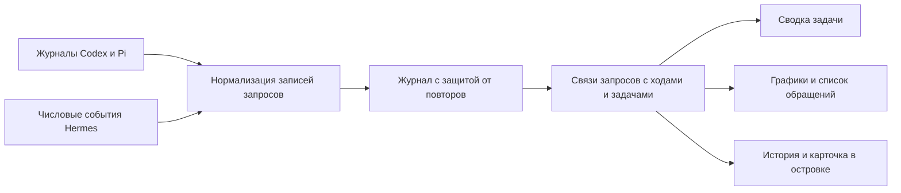

# Расход токенов по задачам

Статус: основной план внедрён в 0.4.26, 22 октября 2026. Ниже сохранено исходное архитектурное решение; фактическая реализация и границы проверки перечислены в конце и в [отчёте проверки](../verification.md).

## Что пользователь должен понять

За несколько секунд экран отвечает на четыре вопроса:

1. Сколько токенов потребовалось для этой задачи вместе с её сабагентами?
2. Сколько модель прочитала и сколько создала?
3. Какая часть входа была повторно использована из кэша?
4. Какие агенты и какие обращения к модели дали основной расход?

Доллары, проценты недельной квоты и размер текущего контекста не входят в эту сводку. Квота остаётся отдельной вкладкой. Токены разных моделей можно складывать как сообщённые счётчики, но такая сумма сама по себе не измеряет качество, цену или эффективность работы.

## Что считать задачей

Автоматическая единица — один запрос пользователя, связанный с нативным ходом агента, и все вызванные им обращения к моделям и дочерним агентам. Инструменты, согласование разрешений и внутренние продолжения в том же ходе не создают новые задачи. Неудачная или отменённая задача сохраняет уже потраченные токены.

Одна цель может занимать несколько пользовательских ходов. Для этого нужна явная команда «Объединить в задачу» с возможностью отмены. Автоматически угадывать одинаковую цель по тексту, паузе или заголовку нельзя. Один и тот же ход не может одновременно принадлежать двум объединённым задачам. По умолчанию каждый самостоятельный нативный ход остаётся отдельной задачей.

Термины в модели:

- `UsageTask`: пользовательская единица просмотра; содержит один или несколько `TurnKey`.
- `TurnKey`: источник + соединение/профиль + сессия + нативный идентификатор хода.
- `UsageRequest`: один подтверждённый расход обращения к модели, принадлежащий конкретному ходу.
- `TaskAttribution`: отдельная связь расхода с корневой задачей и основание этой связи.

Существующий `AgentTask` — пункт плана агента. Он не заменяет `UsageTask`: одно обращение к модели может затрагивать несколько пунктов, поэтому автоматически назначать каждому пункту точное число токенов нельзя.



## Проверенные исходные данные

| Источник | Что уже есть | Что нужно сохранить | Ограничение |
| --- | --- | --- | --- |
| Codex | `thread_id`, `response_id`, `turn_id`, `root_turn_id`, корневая `session_id`, числовой `usage` | Отдельную запись каждого ответа и связь с корневым ходом | Старые журналы могут содержать только накопительный счётчик; его нельзя выдавать за точные отдельные обращения |
| Hermes | `api_request_id`, `session_id`, `turn_id`, время начала/окончания, нормализованный `usage`; у запуска ребёнка есть `parent_turn_id` | Время и модель каждого обращения, родительский ход, назначение вспомогательного вызова | Плагин 1.9 пока отбрасывает часть этих полей; без соединения события не сохраняются для повторной доставки |
| Pi | Идентификаторы сообщений, `parentId`, роль, модель, `responseId`, `usage` | Граф родительских сообщений и ближайший пользовательский запрос для каждого ответа | Произвольная расширяемая система сабагентов не гарантирует межсессионную связь; отсутствующую связь нужно показывать явно |

Локальная проверка: в восьми выбранных файлах дочерних сессий Codex все 55 просмотренных собственных записей расхода содержали `root_turn_id`, который находился среди ходов соответствующей корневой сессии. Это подтверждает возможность точной привязки для этой выборки, а не для каждой старой версии Codex.

В установленном Hermes проверены `agent/turn_response_intake.py`, `agent/api_request_hooks.py`, `tools/delegate_tool.py` и `agent/auxiliary_hooks.py`. Для дочерних вызовов доступен `parent_turn_id`; вспомогательные вызовы могут наследовать текущие session/task/turn. Фоновый вызов без такой связи остаётся отдельной фоновой активностью.

## Что нужно изменить в текущем коде

[`TokenUsage.swift`](../../Sources/SINotch/TokenUsage.swift) уже нормализует токены и хранит `UsageSession.turns`. Но `UsageTurn` — агрегат: у него одна дата и одна модель. Он не сохраняет временную последовательность обращений и изменения модели внутри хода. У Pi ключ этого словаря сейчас соответствует сообщению ассистента, а не пользовательскому ходу.

[`UsageStore.swift`](../../Sources/SINotch/UsageStore.swift) сохраняет идентификаторы обработанных событий Hermes и сумму по ходу. По этому множеству нельзя восстановить расход, время и модель каждого обращения. [`HistorySummary`](../../Sources/SINotch/HistoryStore.swift) уже содержит `sessionKey` и `turnID`, но [`HistoryView`](../../Sources/SINotch/HistoryView.swift) пока показывает сумму всей сессии.

Минимальное расширение:

1. Нормализаторы возвращают числовые `UsageRequest`, сохраняя существующую нормализацию `TokenCounts`.
2. `UsageStore` хранит записи, связи и позиции чтения на прежней последовательной фоновой очереди. Сохранение позиций чтения и соответствующих фактов остаётся атомарным.
3. Отдельный `TaskUsageIndex` вычисляет группы, состояние полноты и агрегаты. Представления не складывают счётчики самостоятельно.
4. `UsageController` публикует готовые неизменяемые снимки. Для навигации вводится `UsageDestination`: сессия, задача или отдельное обращение.
5. History открывает задачу по `sessionKey + turnID`; раскрытая карточка показывает расход текущей задачи, а полная сессия остаётся доступной в деталях.

Новый сервер, опрос процесса на каждый токен и внешние Swift-зависимости не нужны. Нативный Charts подходит для графиков; существующие SwiftUI/AppKit и фоновые очереди сохраняются.

## Записи и правила подсчёта

Запись обращения хранит только идентификаторы, токены и метаданные: `requestKey`, `ownerSessionKey`, `turnKey`, необязательный `rootTurnKey`, `model`, время события/начала/окончания, `TokenCounts`, тип вызова и качество измерения. Сырые ответы, запросы, результаты инструментов, рассуждения и ключи доступа не сохраняются. Название задачи берётся из уже разрешённой History либо задаётся пользователем; при выключенной текстовой истории используется нейтральное название и дата.

`requestKey` учитывает источник, соединение, сессию-владельца и стабильный идентификатор ответа. Повторный импорт, доставка и перезапуск не создают новый расход. Скопированная в ветку история не становится расходом ветки. Конфликт двух значений с одинаковым ключом помечается для сверки, а не складывается.

Привязка и измерение имеют независимую оценку: токены могут быть известны точно, а задача — неизвестна. Неназначенные записи остаются в «Без задачи» и продолжают входить в общий расход. Сумма всех непересекающихся задач и неназначенных записей равна общему расходу в той же области выборки.

Формулы:

```text
Всего = Вход + Выход
Из кэша ⊆ Вход
Сохранено в кэш ⊆ Вход
Рассуждения ⊆ Выход
Задача = сумма уникальных записей основного агента и назначенных ей сабагентов
```

Правила:

- Повторно прочитанный контекст учитывается при каждом обращении: это расход обработки, а не число уникальных слов в чате.
- Кэш — повторное использование входа. Нельзя подписывать его как «бесплатно» или переводить число попаданий в денежную экономию.
- Успешно измеренные повторные обращения считаются каждое; повторная доставка того же события не считается снова. Ошибка без `usage` означает неизвестный расход, а не ноль.
- Накопительный счётчик используется как запасной источник. Он не прибавляется к полным данным отдельных запросов той же области. Неразложенный остаток остаётся явно частичным.
- Для сабагента связь с исходной задачей фиксируется по нативному корневому/родительскому ходу. Поздний ответ после начала следующей родительской задачи остаётся у исходной задачи.
- Повторное использование ребёнка для другой задачи требует новой привязки его конкретного хода. Весь срок жизни дочерней сессии нельзя приписать первому запуску.
- В Pi нужно идти по `parentId` к ближайшему пользовательскому сообщению. Простое правило «последний пользователь в файле» ошибается на ветвлениях.
- Вспомогательные вызовы, включая сжатие контекста, входят в задачу только при наличии доказанной связи. В деталях их можно раскрыть отдельно.
- Общий итог включает известные фоновые расходы отдельной группой. Пользовательский фильтр и подытоги должны иметь одну область подсчёта.

## Сохранность и старые данные

Перед внедрением нового формата — отдельная согласованная миграция и резервная копия старого журнала. Текущий рабочий журнал не меняется этим документом.

Для первой версии достаточно существующего атомарного JSON-хранилища с версией формата, записями обращений, связями и позициями чтения. Ограничение 64 MiB нужно проверять до записи. При достижении предела сохранять доступные сводки, показывать ограничение детализации и не продвигать курсор за несохранённые данные. Не выбрасывать идентификаторы повторов при сохранённом полном расходе: иначе повторный импорт увеличит сумму. Компактизация допустима только с сохранением согласованных границ источника и защиты от повтора.

Миграция выполняется во временный файл с проверкой сумм, затем атомарной заменой; исходный журнал сохраняется для отката. Локальные первичные логи можно перечитать. Старые агрегаты Hermes без отдельных событий остаются историческим итогом: их нельзя искусственно разложить по времени, моделям или задачам. При неполном повторном чтении детализация и старый итог не складываются.

Для надёжного удалённого учёта необходим следующий отдельный этап транспорта: небольшая ограниченная очередь числовых событий Hermes и повторная доставка с теми же ID. Удалять событие из очереди можно после подтверждения записи в журнал, а не после приёма сокетом. Переполнение очереди или разрыв покрытия должен давать отметку неполной истории. Без этого нельзя обещать точный расход за время отключённого Mac.

Все вычисления и чтение выполняются вне главного потока. Сохраняются права каталогов 0700 и файлов 0600. Удаление текстовой History не удаляет числовые метрики; отдельное удаление метрик должно предотвращать немедленное восстановление очищенного диапазона при очередном сканировании.

## Экран задачи

Верхняя часть: название, статус, время, главный агент; крупный итог **вместе с сабагентами** и короткая строка состава. Внутри задачи нет второго конкурирующего «главного» итога.

Пример с условными данными:

```text
Исправить поиск
82 400 токенов · вместе с сабагентами

Вход          64 000
  Из кэша     48 000   Уже входит во вход.
Выход         18 400

Основной агент 34 000 · Сабагенты 48 400
```

Рядом с «Вход» и «Выход» видна короткая подпись, а не только подсказка по наведению. Подробнее раскрываются запись кэша, внутренние рассуждения, отдельные модели и список обращений. Технические ID и названия форматов остаются в диагностике.

Графики по порядку полезности:

1. **Состав расхода.** Одна полоса: вход без чтения из кэша + чтение из кэша + выход. Эти три части не пересекаются и дают итог. Запись кэша и reasoning не становятся дополнительными сегментами. Если часть неизвестна, показывается менее подробная честная разбивка.
2. **Расход по ходу задачи.** Столбец на обращение к модели; выбор показывает агента, модель, точное число и время. Для длинной задачи — группировка по минутам/часам с раскрытием диапазона. Поздно доставленное событие используется по времени источника, а при его отсутствии подписывается время получения.
3. **Агенты.** Горизонтальные полосы для основного агента и сабагентов; переход к расходу конкретного участника. Для нескольких моделей — отдельный переключатель «По агентам / По моделям».
4. **Обзор задач.** Период и сортировка по расходу, самый большой расход, медиана на завершённую задачу. Медиану и сравнения считать только по сопоставимым завершённым задачам с указанным покрытием; активные, неполные и объединённые задачи не смешивать незаметно.

Количество обращений показывается только там, где действительно сохранены отдельные запросы. Скорость выдачи токенов не выводится из общей длительности задачи: она включает ожидание пользователя, инструментов и параллельную работу. Подтверждённые API-времена можно показать отдельно позже.

В CodexBar полезны компактные столбцы, точное значение под выбранным столбцом, переход день → часы, фильтр по источнику, отдельная маркировка неполной истории. Для одной задачи применяем тот же способ раскрытия к обращениям и агентам. Календарную тепловую карту откладываем: она отвечает на вопрос о днях активности, а не о расходе выбранной задачи.

## Тексты для трёх языков

Короткие подписи одинаково различают вход, выход и часть входа из кэша. Не использовать «счётчики», «подмножества», «телеметрия», «агрегация», «учтённые единицы» и английское `reasoning` в русском объяснении. Термины Input / Output / Cache можно привести в справке для сопоставления с другими приложениями.

| Назначение | Русский | English | 简体中文 |
| --- | --- | --- | --- |
| Вкладка | Задачи | Tasks | 任务 |
| Итог | Всего токенов | Total tokens | Token 总量 |
| Вход | Вход | Input | 输入 |
| Подпись входа | Запрос, история чата и данные, переданные модели. | The prompt, chat history and data sent to the model. | 发送给模型的请求、聊天记录和相关数据。 |
| Выход | Выход | Output | 输出 |
| Подпись выхода | Ответ и внутренние рассуждения, если сервис включает их в расход. | The response and internal reasoning, when included in reported usage. | 模型生成的回答，以及服务计入用量的内部推理。 |
| Чтение кэша | Из кэша | From cache | 来自缓存 |
| Подпись кэша | Часть входа, которую сервис использовал повторно. Уже входит во вход. | Input reused by the service. Already included in Input. | 服务重复使用的输入内容。已包含在输入中。 |
| Раскрытие | Подробнее | Details | 详细信息 |
| Запись кэша | Сохранено в кэш | Saved to cache | 写入缓存 |
| Подпись записи | Часть входа, сохранённая для повторного использования. Уже входит во вход. | Input saved for reuse. Already included in Input. | 为后续重复使用而保存的输入内容。已包含在输入中。 |
| Рассуждения | Рассуждения модели | Model reasoning | 模型推理 |
| Подпись рассуждений | Внутренняя работа модели над ответом. Уже входит в выход. | Internal work on the response. Already included in Output. | 模型生成回答时的内部推理。已包含在输出中。 |
| Семья | Вместе с сабагентами | Including subagents | 包含子代理 |
| Основной участник | Основной агент | Main agent | 主代理 |
| Дочерние | Сабагенты | Subagents | 子代理 |
| Пояснение дочерних | Агенты, которым поручили часть этой задачи. | Agents assigned part of this task. | 负责此任务中部分工作的代理。 |
| Неизвестно | Нет данных | No data | 暂无数据 |
| Не сообщено поле | Агент не передал это значение. | The agent did not report this value. | 代理未提供此数据。 |
| Частично | Данные неполные | Incomplete data | 数据不完整 |
| Пояснение частичного | Часть расхода недоступна. Показано то, что удалось получить. | Some usage is unavailable. Showing the available portion. | 部分用量无法获取。仅显示已获取的数据。 |
| Без привязки | Без задачи | Unassigned | 未关联任务 |
| Справка о токенах | Токены — небольшие части текста, которые обрабатывает модель. Один токен не равен одному слову. | Tokens are small pieces of text processed by a model. A token is not the same as a word. | Token 是模型处理文本时使用的小单位，不一定对应一个字或一个词。 |

В справке дополнительно объяснить: изображения и звук тоже могут учитываться в токенах, если источник сообщает их в этих счётчиках. Повторная передача одного и того же текста увеличивает суммарный вход. При неизвестной модальности не называть счётчик числом прочитанных слов.

Нулевой подтверждённый расход показывается как `0`; неизвестное значение — `—` с объяснением. Для неполного общего итога показывается предупреждение рядом с числом. Знак «не меньше» допустим только для доказанной нижней границы, не для конфликтующих измерений. Неизвестная отдельная часть кэша не делает известный общий итог неизвестным.

Числа, краткие единицы, разделители, даты и часовой пояс форматируются по языку приложения. Точные числа доступны при выборе и копировании. Текст не собирается из переведённых фрагментов; для количеств используются полноценные локализованные строки и нужные формы. Цвета дублируются подписями. Клавиатура и VoiceOver позволяют выбрать каждое значение; ошибки не обозначаются одним цветом.

## Порядок реализации и приёмка

1. **Основа данных.** Согласовать миграцию; сохранить запросы, root/parent turn и точность. Сначала сверить сессии старого и нового журнала на копии реальных данных. Затем включить новую запись с возможностью отката.
2. **Задачи и навигация.** Codex root turn; Hermes parent turn; Pi parent graph. History и островок переходят к нужной задаче, а не ко всей сессии. Неназначенные расходы остаются видимыми.
3. **Понятная карточка.** Внедрить короткие подписи и раскрываемые подробности одновременно в en, ru, zh-Hans. Проверить, что из интерфейса понятно: кэш входит во вход, вход + выход дают итог.
4. **Графики.** Состав, обращения по времени, агенты/модели; одна и та же выборка должна давать одинаковую сумму в графике, таблице, History и карточке.
5. **Удалённая надёжность.** Отдельно реализовать подтверждение записи и повторную доставку Hermes; проверить отключение и восстановление SSH без потерь и повторного расхода.

Обязательные сценарии: два задания подряд в одном чате; ребёнок закончил после начала второго задания; повторно использованный ребёнок; смена модели внутри одного хода; разрешение пользователем без новой задачи; новая отдельная реплика; ветка Pi и скопированная история; повторная доставка; рестарт между чтением и сохранением; отмена с уже известным расходом; отсутствующие и нулевые поля; legacy-счётчик рядом с точными запросами; превышение лимита хранения; объединение и отмена объединения задач; очистка текста без потери токенов.

Для каждого языка нужны нативные снимки узкого и обычного окна, длинного названия задачи, пустого/нулевого/частичного состояния и больших чисел. Отдельно — реальные переходы из меню, History и островка в установленной сборке, клавиатура и VoiceOver. Понятность формулировок оценивается человеком; наличие перевода и скриншота само по себе её не доказывает.

Новые обработчики и индексы проходят целевые тесты, затем `scripts/test.sh`, `scripts/build-app.sh release` и `scripts/verify-release.sh`. Сравнить холодное чтение, открытие карточки и нагрузку тёплого простоя с текущей сборкой; изменение графиков не должно запускать повторный разбор журналов.

## Источники

Проверенный снимок CodexBar: `932673aa68878faeee2847d5bf5767ca561fd8f0`.

- [CostHistoryChartMenuView.swift](https://github.com/steipete/CodexBar/blob/932673aa68878faeee2847d5bf5767ca561fd8f0/Sources/CodexBar/CostHistoryChartMenuView.swift): столбцы токенов, выбор точки, неполные записи, модельные и сессионные детали.
- [SpendDashboardTrendPanel.swift](https://github.com/steipete/CodexBar/blob/932673aa68878faeee2847d5bf5767ca561fd8f0/Sources/CodexBar/SpendDashboardTrendPanel.swift): переход день → часы, выбор источника, фильтрация области.
- [UI documentation](https://github.com/steipete/CodexBar/blob/932673aa68878faeee2847d5bf5767ca561fd8f0/docs/ui.md): локализованные подписи, точные значения, отсутствие данных и покрытие истории.
- [Hermes observer hooks](https://github.com/NousResearch/hermes-agent/blob/main/website/docs/developer-guide/observer-hooks.md): контракт наблюдений; конкретные поля дополнительно сверены с установленным runtime.


## Состояние внедрения, 22 октября 2026

Реализованы журнал отдельных обращений с миграцией и резервной копией, явная привязка задач и сабагентов, объединение и отмена объединения, переходы из History и карточки, три графика/разбивки и подписи на трёх языках. Hermes 1.10 использует очередь до подтверждения записи на диск. Новая локальная сборка установлена; восемь существующих профилей Hermes обновлены без изменения настроек.

Независимая сверка 8 159 обращений из реальных журналов Codex/Pi не выявила расхождений. Полная методика, результаты тестов и границы проверки описаны в `docs/verification.md`. Реальная задача Hermes с одним сабагентом дала 89 816 токенов; все пять записей совпали с нативной базой, включая вспомогательный запрос. Пятнадцать повторных доставок не изменили суммы. Физическая проверка VoiceOver не выполнена. Текущая History сохранена.
